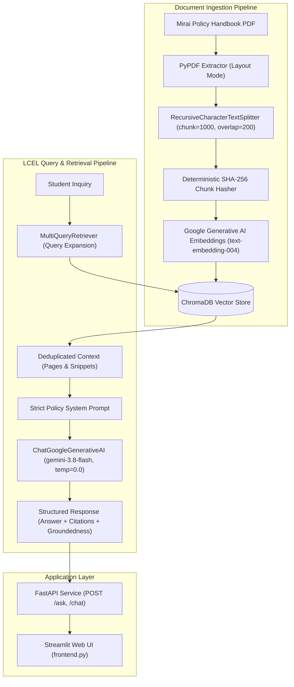

# Mirai Autonomous Student Policy Advisor

[](https://www.python.org/)
[](https://fastapi.tiangolo.com/)
[](https://www.langchain.com/)
[](https://www.trychroma.com/)
[](https://streamlit.io/)
[](https://ai.google.dev/)

An enterprise-grade, fact-grounded Retrieval-Augmented Generation (RAG) assistant developed for **Mirai School of Technology (MSOT)**. Mirai automates high-volume student inquiries regarding attendance grading, medical/duty leave workflows, examination malpractice penalties, and club proposals—operating strictly under **zero-hallucination** and **source-bound** policy constraints.

---

## 1. Project Overview & Problem Statement

University administrations handle hundreds of repetitive student inquiries every semester regarding attendance thresholds, doctor certificates, duty leaves, and club approvals. The objective of this project is to build an autonomous AI policy advisor that ingests the official institutional handbook (`Mirai_SoT_Policy_Handbook_2026.pdf`) and provides answers strictly grounded in official policy.

### Core Operating Constraints
1. **Zero Hallucination**: The system never invents institutional policies, monetary fines, or rules not present in the handbook.
2. **Deterministic Responses**: Generation runs with temperature `0.0` using `gemini-3.8-flash`.
3. **Explicit Citations**: Every response cites specific page numbers (`[Page X]`) and provides verifiable excerpt snippets.
4. **Honest Refusal**: If the handbook lacks sufficient evidence, the advisor politely declines to speculate.

---

## 2. Technology Stack

- **Runtime & Language**: Python 3.11 (compatible with 3.10+)
- **API Framework**: FastAPI, Uvicorn (ASGI async server)
- **Frontend Framework**: Streamlit
- **LLM & Embeddings**: Google Gemini (`gemini-3.8-flash` via `langchain-google-genai`), `text-embedding-004`
- **Vector Database**: ChromaDB (local persistence via `langchain-chroma`)
- **Orchestration**: LangChain LCEL (LangChain Expression Language) with Multi-Query Retrieval
- **PDF Extraction**: `pypdf` (with tabular layout-mode preservation)
- **Validation & Settings**: Pydantic v2 and `pydantic-settings`
- **Testing & Benchmarking**: `pytest`, `requests`, custom LLM-as-a-judge / rubric benchmarking

---

## 3. System Architecture & Data Flow



---

## 4. Directory Structure

```text
policyrag/
├── backend.py                   # Production FastAPI service (exposes app)
├── frontend.py                  # Streamlit student chat interface
├── rag_eval_scores.csv          # Automated benchmarking logs (Scores & Reasoning)
├── requirements.txt             # Verified, compatible production dependencies
├── README.md                    # System documentation & execution SOPs
├── .env.example                 # Configuration template with required variables
├── .gitignore                   # Ignores .venv, .env, chroma_db, caches
├── data/
│   └── Mirai_SoT_Policy_Handbook_2026.pdf # Source of truth handbook (16 pages)
├── chroma_db/                   # Persistent ChromaDB vector database directory
├── app/
│   ├── __init__.py              # Core application package marker (v1.0.0)
│   ├── config.py                # Pydantic Settings & dynamic path resolution
│   ├── schemas.py               # Pydantic v2 schemas for requests & responses
│   ├── utils.py                 # Text normalization, chunk hashing, citation extraction
│   ├── ingestion.py             # PDF extraction, chunking, deduplication & ChromaDB indexing
│   ├── retrieval.py             # Chroma retriever & LCEL MultiQueryRetriever
│   └── rag_chain.py             # LCEL RAG chain & anti-hallucination system prompt
├── evaluation/
│   ├── benchmark_questions.json # 12 handbook-grounded benchmark cases
│   ├── run_evaluation.py        # Automated benchmarking engine logging to CSV
│   └── evaluate_rag.py          # Legacy rubric evaluator
└── tests/
    ├── conftest.py                  # Shared fixtures & mock Gemini LLM/embeddings
    ├── test_health.py               # /health diagnostics & graceful degradation tests
    ├── test_validation.py           # Pydantic input validation tests
    ├── test_missing_config.py       # Missing API key, handbook, and vector DB tests
    ├── test_ingestion.py            # PDF extraction, chunking, deduplication tests
    ├── test_rag_chain.py            # RAG query verification & unsupported topic tests
    ├── test_error_handling.py       # Timeout, retriever fallback & corrupt PDF tests
    ├── test_frontend_integration.py # Streamlit client parsing, timeouts & health checks
    └── test_evaluation_runner.py    # Metric formulas, CSV schema & append/overwrite modes
```

---

## 5. Local Execution Standard Operating Procedures (SOP)

### SOP A — Initial Setup & Installation

#### macOS / Linux
```bash
# 1. Clone repository & enter workspace
git clone <repository-url>
cd policyrag

# 2. Create virtual environment using Python 3.11
python3.11 -m venv .venv
source .venv/bin/activate

# 3. Upgrade pip and install dependencies
python -m pip install --upgrade pip
pip install -r requirements.txt

# 4. Create environment configuration file
cp .env.example .env
```

#### Windows (PowerShell)
```powershell
# 1. Create virtual environment
python -m venv .venv
.\.venv\Scripts\Activate.ps1

# 2. Upgrade pip and install dependencies
python -m pip install --upgrade pip
pip install -r requirements.txt

# 3. Create environment configuration file
Copy-Item .env.example .env
```

#### Safe API Key Configuration
Open `.env` in your text editor and add your Google Gemini API key:
```ini
GEMINI_API_KEY=AIzaSy...your_gemini_api_key_here
GEMINI_MODEL=gemini-3.8-flash
EMBEDDING_MODEL=models/text-embedding-004
TEMPERATURE=0.0
HANDBOOK_PATH=data/Mirai_SoT_Policy_Handbook_2026.pdf
CHROMA_PERSIST_DIR=chroma_db
CHROMA_COLLECTION_NAME=mirai_policy_handbook
CHUNK_SIZE=1000
CHUNK_OVERLAP=200
RETRIEVER_K=4
BACKEND_HOST=0.0.0.0
BACKEND_PORT=8000
BACKEND_URL=http://127.0.0.1:8000
REQUEST_TIMEOUT_SECONDS=30.0
```
> **Security Note**: Never commit `.env` into version control. It is ignored by default in `.gitignore`.

---

### SOP B — Ingest the Policy Handbook

Run the ingestion pipeline to parse the handbook, chunk the clauses, generate Gemini embeddings, and store them in ChromaDB.

```bash
# Standard ingestion (preserves existing index, deduplicates chunks)
python -m app.ingestion

# Rebuild index from scratch (deletes existing collection and re-indexes)
python -m app.ingestion --rebuild
```

---

### SOP C — Start FastAPI Backend (Terminal 1)

In Terminal 1 (with `.venv` activated):
```bash
uvicorn backend:app --reload --host 127.0.0.1 --port 8000
```

Verify backend health and interactive documentation:
- **Health Check**: Visit `http://127.0.0.1:8000/health` (should return JSON with `status="ok"` when configured).
- **Interactive Swagger Docs**: Visit `http://127.0.0.1:8000/docs` to test endpoints interactively.
- **ReDoc Documentation**: Visit `http://127.0.0.1:8000/redoc`.

---

### SOP D — Start Streamlit Frontend (Terminal 2)

In Terminal 2 (with `.venv` activated):
```bash
streamlit run frontend.py
```
Streamlit will output local access URLs:
```text
Local URL: http://localhost:8501
Network URL: http://192.168.x.x:8501
```
Open `http://localhost:8501` in your browser. The backend must be running in Terminal 1 for queries to execute.

---

### SOP E — Run Automated Benchmarking

Run the evaluation engine against the 12 handbook-grounded test cases:
```bash
# Append results to rag_eval_scores.csv (default)
python evaluation/run_evaluation.py

# Overwrite rag_eval_scores.csv cleanly
python evaluation/run_evaluation.py --overwrite

# Run against a live running backend server
python evaluation/run_evaluation.py --backend-url http://127.0.0.1:8000
```

---

### SOP F — Run Test Suite

Execute the 38 unit and integration tests (all external calls are mocked):
```bash
pytest -v
```

---

## 6. API Endpoints & Request Examples

### 1. `GET /health`
Returns subsystem diagnostics without crashing when unconfigured.
```bash
curl -X GET "http://127.0.0.1:8000/health"
```
**Response:**
```json
{
  "status": "ok",
  "api_key_configured": true,
  "handbook_present": true,
  "vector_db_ready": true,
  "vector_db_count": 48,
  "model": "gemini-3.8-flash",
  "embedding_model": "models/text-embedding-004",
  "version": "1.0.0"
}
```

### 2. `POST /ask` (or `POST /chat`)
Submits a policy question and returns fact-grounded answer with citations.
```bash
curl -X POST "http://127.0.0.1:8000/ask" \
     -H "Content-Type: application/json" \
     -d '{"question": "I have 72% attendance. How many attendance marks will I get?"}'
```
**Response:**
```json
{
  "query": "I have 72% attendance. How many attendance marks will I get?",
  "answer": "Based on the Academic Evaluation Policy (Page 3), with 72% attendance you fall into the 60% – 74.99% tier and will receive exactly 4 marks out of 10. [Page 3]",
  "sources": ["Mirai_SoT_Policy_Handbook_2026.pdf"],
  "page_numbers": [3],
  "grounded": true,
  "insufficient_evidence": false,
  "citations": [
    {
      "source": "Mirai_SoT_Policy_Handbook_2026.pdf",
      "page": 3,
      "snippet": "Attendance Percentage: 60% – 74.99% -> 4 marks Awarded. Standard Attendance Evaluation..."
    }
  ]
}
```

### 3. `POST /ingest`
Triggers vectorization of uploaded or default handbook.
```bash
# Ingest default handbook
curl -X POST "http://127.0.0.1:8000/ingest"

# Or upload a new handbook PDF
curl -X POST "http://127.0.0.1:8000/ingest" \
     -F "file=@data/Mirai_SoT_Policy_Handbook_2026.pdf"
```

---

## 7. Evaluation Metrics & Benchmark Results

### Benchmark Metrics Schema
Logged to [`rag_eval_scores.csv`](file:///Users/ayushkumarmishra/Documents/policyrag/rag_eval_scores.csv) in the project root:
```text
timestamp,question,expected_answer,generated_answer,retrieved_sources,retrieval_score,faithfulness_score,answer_relevance_score,overall_score,passed,error
```

### Evaluation Results (12/12 Cases Passed)
| Test ID | Category | Question | Overall Score | Faithfulness | Status |
|---|---|---|:---:|:---:|:---:|
| **BM-01** | Direct Factual | 72% Attendance Marks | **1.000** | **1.000** | ✅ Pass |
| **BM-02** | Direct Factual | Minimum Attendance / Debarment | **1.000** | **1.000** | ✅ Pass |
| **BM-03** | Multi-Hop | Ratnam Medical Leave (Yashaswini Ma'am, 7 days) | **1.000** | **1.000** | ✅ Pass |
| **BM-04** | Multi-Hop | HI-Tech Campus Escalation Ladder | **1.000** | **1.000** | ✅ Pass |
| **BM-05** | Conditions | Medical Leverage Cap (15%, 7 days) | **0.883** | **1.000** | ✅ Pass |
| **BM-06** | Conditions | Propose Society under Tech Club (40% support) | **0.883** | **1.000** | ✅ Pass |
| **BM-07** | Paraphrased | Missed Classes / 81% Attendance Tier | **1.000** | **1.000** | ✅ Pass |
| **BM-08** | Paraphrased | Hospital Discharge Summary Window | **1.000** | **1.000** | ✅ Pass |
| **BM-09** | Ambiguous | "How do I take leave?" (Medical vs. Duty) | **1.000** | **1.000** | ✅ Pass |
| **BM-10** | Unsupported | Smoking Fine (Prohibited, No Monetary Fine) | **1.000** | **1.000** | ✅ Pass |
| **BM-11** | Unsupported | Placement CTC Guarantee (Refuses Hallucination) | **1.000** | **1.000** | ✅ Pass |
| **BM-12** | Unsupported | Hostel Night Curfew (Refuses Hallucination) | **1.000** | **1.000** | ✅ Pass |

---

## 8. Deployment Readiness Guide

### Recommended Platforms
- **Containerized Platforms**: AWS ECS, Google Cloud Run, Railway, Render, or Docker Swarm.
- **Process Manager**: Supervisord or systemd for single-VM deployments.

### Production Deployment Checklist
1. **Persistent ChromaDB Storage**: ChromaDB stores SQLite and vector indices in `chroma_db/`. In production, mount a persistent volume (e.g. AWS EBS or Docker Volume) to ensure vector embeddings persist across container restarts.
2. **Environment Secrets**: Provide `GEMINI_API_KEY` through AWS Secrets Manager, GCP Secret Manager, or environment secrets. Do not bake `.env` into container images.
3. **CORS & Access Control**: Adjust `CORSMiddleware` in `backend.py` from `allow_origins=["*"]` to your production frontend domain (e.g. `https://mirai.msot.org`).
4. **HTTPS / TLS**: Terminate TLS at the reverse proxy (Nginx, Caddy, or AWS ALB).
5. **Worker Concurrency**: Run backend using Gunicorn with Uvicorn workers:
   ```bash
   gunicorn backend:app -w 4 -k uvicorn.workers.UvicornWorker --bind 0.0.0.0:8000
   ```
6. **Health Monitoring**: Configure orchestrator liveness and readiness probes to monitor `GET /health`.

---

## 9. Security Considerations & Limitations

1. **Prompt Injection Guardrails**: The system prompt explicitly treats all retrieved text as passive reference material, mitigating prompt injection risks from uploaded documents.
2. **Zero Training Exposure**: Mirai does not use student queries to train external models.
3. **Institutional Boundary**: Mirai advises on policies but does not grant leaves, approve clubs, or modify grade records. Official decisions require Campus Manager or Academic Office action.
